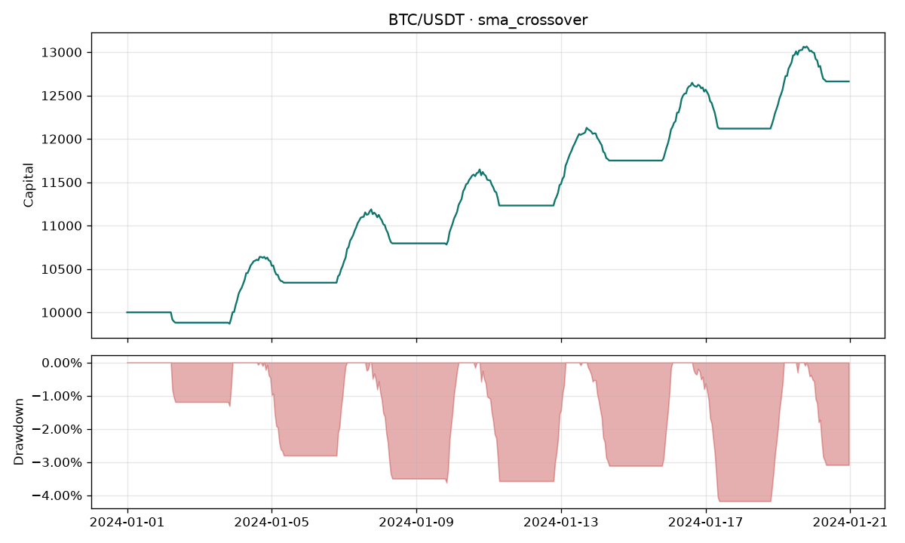

# cryptobot

[](https://github.com/eniquecerrud/crypto-trading-bot/actions/workflows/ci.yml)

Bot de trading de criptomonedas en Python: datos de mercado, estrategias enchufables, backtest con costes y un modo paper que simula la cartera. El trading con dinero real existe, pero está apagado hasta que lo actives a propósito en tres sitios a la vez.

## Aviso de riesgo

Esto es un proyecto de estudio y de portafolio. **No es asesoría financiera, de inversión ni una invitación a comprar o vender criptoactivos.** Operar con criptomonedas puede hacerte perder todo el capital. Un backtest, por bueno que se vea, no predice el futuro: no incluye todos los fallos de un exchange, ni huecos de liquidez, ni noticias, ni el hecho de que la estrategia se haya ajustado mirando los mismos datos.

La serie de ejemplo es sintética. Las cifras que imprime el comando de demostración sirven para comprobar que el programa corre, no para decidir una operación. Si activas el modo en vivo, el programa puede enviar órdenes reales. Hazlo solo con claves de permiso limitado, mejor en sandbox, y con una cantidad que puedas perder.

## Qué incluye

- Descarga de velas OHLCV con [ccxt](https://github.com/ccxt/ccxt), caché en CSV o SQLite, y lectura de CSV sin red para tests y ejemplos.
- Indicadores con pandas y NumPy: SMA, EMA, RSI de Wilder y bandas de Bollinger.
- Estrategias intercambiables: cruce de SMA, cruce de EMA, reversión con RSI, reversión y ruptura con Bollinger.
- Backtest vela a vela con comisiones, slippage, tamaño de posición, stop-loss y take-profit.
- Métricas: retorno total, CAGR, Sharpe, Sortino, drawdown máximo, tasa de aciertos y número de operaciones. El gráfico de capital se guarda en PNG.
- Paper trading: contra un CSV (mismos fills que el backtest) o contra el último precio del exchange, siempre con cartera simulada.
- Riesgo: tope de tamaño de posición y límite de pérdida diaria en UTC. Si se alcanza, no se abren entradas nuevas; las salidas siguen permitidas.
- CLI (`cryptobot`) y configuración YAML o TOML.
- Logs estructurados en texto o JSON.
- Tests con pytest sobre datos sintéticos, sin red. CI en Python 3.10–3.13.

## Arquitectura

```
CSV o ccxt
    │
    ▼
velas OHLCV ──► estrategia ──► objetivo (−1, 0, 1) por vela cerrada
                                      │
                                      ▼
                                 gestión de riesgo
                                      │
          ┌───────────────────────────┼───────────────────────────┐
          ▼                           ▼                           ▼
     backtest                    paper                        live
  (histórico, sin red         (cartera simulada)         (spot, opt-in)
   si source es csv)               │                           │
          │                        │                           │
          ▼                        ▼                           ▼
   métricas + PNG            registro de marks            órdenes de mercado
```

La estrategia no manda órdenes. Mira velas ya cerradas y dice si quiere estar largo (`1`), plano (`0`) o corto (`-1`). En el backtest, esa decisión se ejecuta en la **apertura de la vela siguiente**, con slippage en contra. Así no se usa el cierre de la propia vela como precio de fill. Si una vela toca el stop y el take-profit, gana el stop. Un hueco que atraviesa el nivel se llena al precio de apertura, no a un precio que el mercado no negoció.

El corto es un modelo de margen simplificado y viene desactivado. En spot en vivo una señal corta se trata como plano: esta versión no abre cortos reales.

## Instalación

Hace falta Python 3.10 o superior.

```bash
python -m venv .venv
source .venv/bin/activate
pip install -e ".[dev]"
```

Los comandos de abajo se ejecutan desde la raíz del repositorio, porque las rutas del ejemplo (`data/sample/...`) son relativas al directorio de trabajo.

## Inicio rápido

No hace falta red ni claves:

```bash
cryptobot list-strategies
cryptobot backtest --config configs/example.yaml
cryptobot paper --config configs/example.yaml --iterations 80
```

El backtest de ejemplo, con el CSV sintético de BTC/USDT en 1h y un cruce de medias 10/30, imprime algo así:

```
Símbolo           BTC/USDT
Estrategia        sma_crossover
Retorno total     26.61%
CAGR              7407.91%
Sharpe            17.637
Sortino           31.631
Drawdown máximo   -4.18%
Tasa de aciertos  42.86%
Operaciones       14
Capital inicial   10,000.00
Capital final     12,661.46
Posición abierta  plana 0
```

Ese CAGR no es una previsión. La muestra dura 480 horas, unas tres semanas. Anualizar un retorno corto produce un número enorme y el Sharpe se infla con pocas observaciones y con una serie construida a propósito (una onda más deriva). El gráfico queda en `artifacts/equity.png` y las operaciones en `artifacts/trades.csv`.



Otra configuración de la misma muestra, con RSI:

```bash
cryptobot backtest --config configs/rsi.example.yaml
```

## Comandos

| Comando | Qué hace | ¿Usa la red? | ¿Envía órdenes? |
| --- | --- | --- | --- |
| `list-strategies` | Nombre, descripción y parámetros por defecto | No | No |
| `backtest -c archivo` | Simula la estrategia y escribe métricas, PNG y CSV | Solo si `data.source` es `exchange` | No |
| `paper -c archivo` | Cartera simulada | Solo si `data.source` es `exchange` | No |
| `fetch -c archivo --since ...` | Descarga velas y las guarda en la caché | Sí | No |
| `live -c archivo` | Órdenes spot de mercado | Sí | Sí, si pasan los tres candados |

Opciones útiles:

```bash
cryptobot backtest -c configs/example.yaml \
  --equity-plot artifacts/equity.png \
  --trades-csv artifacts/trades.csv

cryptobot paper -c configs/example.yaml --iterations 80 --pace 0.2
cryptobot --version
```

`--iterations` en un CSV limita las primeras velas. `--pace` espera esos segundos entre líneas del replay; con `0` (el defecto) recorre el archivo de una vez. Contra un exchange, `--iterations` es el número de consultas y la espera es `paper.poll_seconds`.

## Configuración

YAML o TOML. `configs/example.yaml` es el punto de partida. Las claves desconocidas se rechazan, y también cualquier campo que parezca un secreto (`api_key`, `secret`, `password`, `token`, …). Las credenciales solo se leen del entorno.

```yaml
exchange: binance
symbol: BTC/USDT
timeframe: 1h

data:
  source: csv            # csv | exchange
  csv_path: data/sample/BTC-USDT-1h.csv
  cache_dir: data/cache
  cache_backend: csv     # csv | sqlite
  sqlite_path: data/cache/ohlcv.sqlite

strategy:
  name: sma_crossover
  params:
    fast_window: 10
    slow_window: 30

backtest:
  initial_cash: 10000
  fee_rate: 0.001       # 0,1 % del nocional en cada fill
  slippage_bps: 5       # 5 puntos básicos en contra
  position_size_pct: 0.95
  stop_loss_pct: 0.03   # null para desactivarlo
  take_profit_pct: 0.08
  allow_short: false
  close_at_end: false   # true cierra la posición al último cierre

risk:
  max_position_pct: 0.95
  max_daily_loss_pct: 0.10   # null desactiva el límite diario

paper:
  poll_seconds: 60
  lookback: 300

live:
  enabled: false
  sandbox: true

logging:
  level: INFO            # DEBUG | INFO | WARNING | ERROR | CRITICAL
  json: false

output:
  equity_curve: artifacts/equity.png
  trades_csv: artifacts/trades.csv
```

El tamaño efectivo de una entrada es el mínimo entre `backtest.position_size_pct` y `risk.max_position_pct`. En largos, la comisión se reserva para no gastar más caja de la que hay.

`fee_rate` es una fracción (0.001 = 10 puntos básicos). `slippage_bps` son puntos básicos: las compras se encarecen y las ventas se abaratan.

## Estrategias

Todas reciben las velas cerradas y devuelven una serie alineada. El valor de la barra `t` solo puede depender de barras hasta `t`.

| Nombre | Idea | Parámetros |
| --- | --- | --- |
| `sma_crossover` | Largo mientras la SMA rápida está por encima de la lenta | `fast_window`, `slow_window` |
| `ema_crossover` | Igual, con medias exponenciales (`adjust=False`) | `fast_window`, `slow_window` |
| `rsi_mean_reversion` | Compra si el RSI cae por debajo de `oversold` y sale al superar `exit_long` | `window`, `oversold`, `overbought`, `exit_long`, `exit_short` |
| `bollinger_reversion` | Compra bajo la banda inferior y sale en la media | `window`, `num_std` |
| `bollinger_breakout` | Compra por encima de la banda superior y sale si el precio vuelve bajo la media | `window`, `num_std` |

Con `allow_short: true` las reglas se espejan y la serie puede valer `-1`. Sin eso, toda señal corta se convierte en plano. `fast_window` tiene que ser menor que `slow_window`. Las ventanas son enteros; un `10.0` de YAML también vale.

Para añadir una estrategia: subclase de `Strategy`, decorador `@register`, y un import en `cryptobot.strategies` para que el registro la vea. `generate` debe ser causal.

## Datos

El marco canónico tiene un índice temporal en UTC y las columnas `open`, `high`, `low`, `close`, `volume`. El CSV acepta `timestamp`, `time` o `date`, en ISO-8601 o en epoch (segundos o milisegundos). Se rechazan precios no positivos, máximos que no cubren la vela y marcas de tiempo duplicadas.

Ejemplo mínimo:

```csv
timestamp,open,high,low,close,volume
2024-01-01T00:00:00Z,42000,42100,41900,42050,12.5
```

`data/sample/BTC-USDT-1h.csv` se regenera con semilla fija:

```bash
python scripts/generate_sample_data.py
```

Para guardar historia real en la caché:

```bash
cryptobot fetch --config configs/example.yaml --since 2024-01-01T00:00:00Z
```

Eso sí usa la red. Con `data.source: exchange` el backtest y el paper también. La caché CSV vive en `data/cache/<exchange>/<símbolo>/<temporalidad>.csv`. Con `cache_backend: sqlite` todo va a un solo archivo. `fetch` pide páginas hacia adelante desde `--since` (o desde la última vela ya guardada).

En paper contra el exchange se descarta la última vela si todavía se está formando, y el fill es el `last` del ticker, no el high/low de una vela que aún no existe. El replay de un CSV, en cambio, usa el mismo motor que el backtest, stops intradía incluidos.

## Métricas

Se calculan sobre la curva de capital marcada al cierre de cada vela, no solo sobre operaciones cerradas. Una posición que sigue abierta cuenta en el retorno y no cuenta en la tasa de aciertos.

- **Retorno total:** capital final / capital inicial − 1.
- **CAGR:** ese retorno compuesto por el tiempo real entre la primera y la última vela (año de 365,25 días, porque el cripto no cierra el fin de semana).
- **Sharpe y Sortino:** media de los retornos por vela, tasa libre de riesgo 0, anualizados con la mediana del espaciado entre velas. Sortino usa la raíz de la media de los retornos negativos al cuadrado. Si el denominador es 0 y la media es positiva, el resultado es infinito.
- **Drawdown máximo:** la peor caída desde un máximo previo de la curva.
- **Tasa de aciertos:** operaciones cerradas con PnL positivo, divididas por el número de cierres. Sin cierres, `n/a`.

`close_at_end: true` cierra lo que quede al último cierre (motivo `end`) para que entre en la tasa de aciertos. El defecto es dejarla marcada a mercado.

## Paper y live

Paper es el camino normal. No lee claves y no llama a `create_order`.

Live es otro comando y exige las tres cosas:

1. `live.enabled: true` en el archivo de configuración.
2. El flag `--i-understand-live-trading`.
3. `CRYPTOBOT_ENABLE_LIVE=true` en el entorno, más `CRYPTOBOT_API_KEY` y `CRYPTOBOT_API_SECRET`. Algunas cuentas (OKX, por ejemplo) también usan `CRYPTOBOT_API_PASSWORD`.

```bash
cp .env.example .env
# edita .env; no lo subas a git

cryptobot live --config configs/live.yaml --i-understand-live-trading
```

Si falta cualquiera de los candados, el comando termina con código 2 y no construye el cliente autenticado. `.env` está en `.gitignore`. `.env.example` deja las claves vacías y el opt-in en `false`.

`live.sandbox: true` llama a `set_sandbox_mode` de ccxt. Si el exchange no lo ofrece, el programa se detiene en lugar de operar en producción por accidente. Aun así, un sandbox mal configurado puede no ser inofensivo: revisa la documentación del exchange.

El modo en vivo de esta versión es **spot y solo largo**. El símbolo tiene que ser `BASE/QUOTE` (por ejemplo `BTC/USDT`), no un contrato `BTC/USDT:USDT`. El saldo se lee en cada consulta. El precio de entrada para el stop es el fill de la orden que envió este proceso, o el último precio si al arrancar ya había inventario.

## Logs

Por defecto, una línea legible en stderr:

```
2026-01-01T00:00:00+00:00 INFO cryptobot.backtest.engine operación cerrada pnl=-119.061 reason=signal side=long symbol=BTC/USDT
```

Con `logging.json: true` cada línea es un objeto JSON (`ts`, `level`, `logger`, `message` y los campos extra). Los errores de una orden en vivo se registran sin la clave ni el secreto.

## Desarrollo

```bash
pip install -e ".[dev]"
ruff check .
ruff format --check .
pytest
```

Los tests no abren sockets. El backtest, los indicadores, el riesgo, la caché, el paper y el rechazo del modo live se cubren con velas construidas en memoria y con el CSV de muestra. La integración con un exchange real no forma parte de la suite.

CI (`.github/workflows/ci.yml`) hace lo mismo en Python 3.10, 3.11, 3.12 y 3.13.

### Docker

```bash
docker build -t cryptobot .
docker run --rm cryptobot backtest --config configs/example.yaml
```

La imagen usa el mismo ejemplo offline. No copies un `.env` con claves dentro de la imagen.

## Estructura

```
src/cryptobot/
  cli.py            comandos
  config.py         YAML / TOML
  logsetup.py       logs de texto o JSON
  data/             CSV, SQLite, descarga ccxt
  indicators/       SMA, EMA, RSI, Bollinger
  strategies/       interfaz y estrategias incluidas
  risk/             tamaño máximo y pérdida diaria
  execution/        cartera simulada, paper y live
  backtest/         motor, métricas y gráfico
configs/            ejemplos
data/sample/        OHLCV sintético
tests/              pytest, sin red
```

## Limitaciones

- Un solo símbolo y una sola posición a la vez. No hay cartera de varios activos.
- El corto simulado no modela liquidaciones ni intereses. Puede dejar la caja en negativo si el precio salta el stop.
- El paper contra el exchange no ve el high/low entre consultas: el stop se evalúa con el último precio.
- No hay websocket, ni órdenes límite, ni reintentos sofisticados si el exchange responde tarde.
- El ancla de la pérdida diaria es el capital en la primera marca de ese día UTC, no el cierre del día anterior.
- Las precisiones de cantidad dependen de `amount_to_precision` del exchange. Un mínimo nocional del mercado puede rechazar la orden igualmente.

Ideas naturales para seguir: más estrategias, walk-forward para no optimizar a ojo sobre el mismo tramo, estado del paper guardado entre reinicios, y un modo testnet documentado exchange por exchange.

## Licencia

MIT. Ver [LICENSE](LICENSE).
